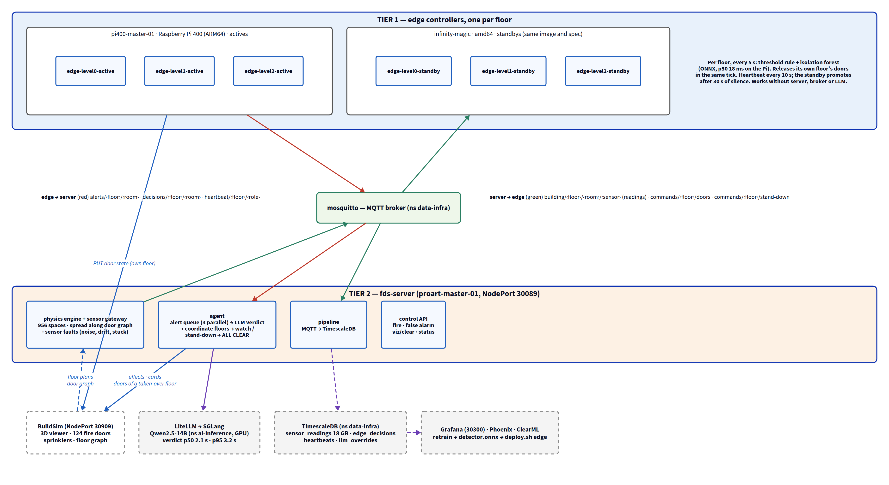

# Fire Detection & Autonomous Response at the Edge

Course project for **D7065E Embedded Intelligence at the Edge**, Luleå University of Technology.
Binay Mishra, Group 3. Final report: [`docs/Group_3_FinalReport.pdf`](docs/Group_3_FinalReport.pdf).

A two-tier fire detection and response system for LTU's A-building, running against the
BuildSim building simulator (950 rooms, three floors, 124 fire doors).

- **Tier 1** — one edge controller per floor on a Raspberry Pi. It reads every room's smoke, CO
  and temperature, decides on a deterministic multi-sensor rule plus an isolation forest for
  the ambiguous band, and releases its own floor's fire doors within one 5 s tick. It needs
  neither the server, nor the broker, nor the LLM to do that. A standby controller on a second
  node takes the floor over 30 s after the active one goes silent.
- **Tier 2** — a server agent. It asks a self-hosted LLM for a verdict on every edge alert,
  releases the doors on the other floors, computes evacuation routes, drives the 3D viewer,
  and stands the building down once readings have been clear for 60 s. If a floor has no
  controller at all, the server takes it over and actuates its doors directly.



## Measured on the project cluster

| Metric | Value |
|---|---|
| Ignition → own-floor doors released (edge, Pi 400) | 14.7 s (smoke build-up + 5 s tick) |
| Isolation-forest inference per room, Pi 400 / amd64 | p50 17.8 / 2.3 ms, p95 33.0 / 6.4 ms |
| Edge alert → LLM verdict (Qwen2.5-14B on SGLang) | p50 2.1 s, p95 3.2 s |
| Verdict → cross-floor door release | 25 ms |
| Standby promotion after active controller loss | 30 s |
| Server takeover of a floor with no controller | 30 s (90 s grace after server boot) |
| Fire out → ALL CLEAR (CO decay + 60 s clear window) | ~7 min for a 45 s fire |

Nine acceptance scenarios pass, including controller failover mid-incident, server takeover of
a floor, LLM outage, broker restart and cold start (report, Sections 10–11).

## How a decision is made

**Tier 1** (`edge/edge_controller.py`), per room every 5 s:

| Readings | Decision | Action |
|---|---|---|
| smoke ≥ 10 and CO ≥ 20 | `fire` | release all doors on this floor, alert the server |
| CO sensor frozen ≥ 60 s and smoke ≥ 20 | `fire` | same: a known-faulty sensor cannot block detection |
| smoke ≥ 5 and the isolation forest flags the window | `possible` | alert the server (Tier 2 decides) |
| smoke ≥ 10, model quiet | `possible` | safety net |
| back below threshold | `clear` | tells the server the room is clear |

The rule is evaluated first and the learned model cannot override it.

**Tier 2** (`src/fds/agent/agent.py`), per alert, three in parallel: the LLM returns
`{is_fire, confidence}` plus alert text and the response is derived deterministically.
Confidence ≥ 0.7 confirms (cross-floor release, routes, viewer effects); anything lower puts
the room on a 60 s watch where the readings decide — clear → stand-down, fire level →
escalate, in between → keep watching. ALL CLEAR re-locks every floor. With the LLM
unreachable the same multi-sensor rule is applied as a fallback.

**What survives what**

| Failure | Behaviour |
|---|---|
| Active edge controller dies | standby promotes after 30 s of missed heartbeats, demotes when the active returns; a handover never re-locks doors |
| Both controllers of a floor down | server takes the floor over after 30 s, actuates its doors directly, hands back on the first heartbeat |
| LLM unreachable | rule-based fallback confirms or rejects immediately; viewer cards say "fallback mode" |
| MQTT broker restart | clients reconnect; the edge keeps ticking on its last readings meanwhile |
| Stuck sensor | a value frozen ≥ 60 s is reported stale; stand-down ignores it, detection falls back to strong smoke alone |
| Server restart | edges keep their floors; stand-down carries `floor_clear`/`relock`, so a restarted controller still re-locks |

## Repository layout

```
docs/                         report (LaTeX + PDF), diagram sources (D2) and renders, screenshots
k8s/buildsim/                 BuildSim deployment
fire-detection-sim/
  edge/edge_controller.py     Tier 1 controller (one process per floor and role)
  edge/detector.onnx          the deployed isolation forest
  src/fds/agent/              Tier 2 agent, prompts, LLM client
  src/fds/physics/            physics engine (heat, smoke, CO, spread), sensor gateway with faults
  src/fds/pipeline/           MQTT → TimescaleDB consumer and schema
  src/fds/models/             detector, retraining (ClearML), spread, evacuation
  src/fds/api/control.py      control API: fire start/stop, false alarm, viewer clear, status
  src/fds/run_full.py         server entry point
  k8s/                        server.yaml; render_edge.py → edge.yaml (six deployments)
  scripts/deploy.sh           build, ship and apply; `check` is the pre-flight
  scripts/door_check.py       door state per floor, straight from BuildSim
  scripts/db_check.py         row counts per table for a time window
  grafana/                    build_dashboards.py → operations.json, technical.json
  tests/                      68 offline tests; broker, BuildSim, ONNX, LLM and DB replaced by in-memory stand-ins
```

## Running it

Prerequisites: a k3s cluster with one node per role, labelled `fds-role=edge-active`
(Raspberry Pi, arm64), `fds-role=edge-standby` (amd64) and `fds-role=server` (amd64 with a GPU);
BuildSim, Mosquitto, TimescaleDB and a LiteLLM endpoint reachable from the cluster; `docker`
with `buildx` and `ssh` access to the two edge nodes from the server node. The server pod
reads `LITELLM_API_KEY` and `DB_PASSWORD` from a Kubernetes Secret `fds-app`, which is created
once by hand and is not in git. Tooling on the development machine reads the same values
through `fds.secrets.get_secrets()`. Copy `configs/config.yaml.example` to `configs/config.yaml`
and fill in your endpoints.

```bash
cd fire-detection-sim
python3 -m venv venv && source venv/bin/activate
pip install -e ".[all,dev]"

scripts/deploy.sh check      # images on each node, Secret fds-app, pods — changes nothing
scripts/deploy.sh            # build both images, ship the edge image to both edge nodes, apply, restart
scripts/deploy.sh edge       # or only the edge / server half
scripts/deploy.sh server
```

Images are node-local (`imagePullPolicy: Never`, imported with `k3s ctr images import`); there
is no registry.

Start order after a full stop: BuildSim first, then the server and the six edge deployments
together. The edges retry door discovery and the broker connection, and the server waits 90 s
after its own start before it would take over a silent floor.

```bash
NS=ai-edge-intel-course
kubectl -n $NS scale deploy/buildsim --replicas=1 && kubectl -n $NS rollout status deploy/buildsim
kubectl -n $NS scale deploy --all --replicas=1
curl -s localhost:30089/status                      # {"running":true,...,"rooms":950}
```

Stop everything with `kubectl -n $NS scale deploy --all --replicas=0`; the edge pods end as
`Completed`.

### Running a scenario

```bash
# terminal 1: what the server decides
kubectl -n $NS logs -f deploy/fds-server | grep --line-buffered -i "ALERT from\|LLM verdict\|LLM doubts\|CROSS-FLOOR\|STAND-DOWN\|ALL CLEAR\|takeover\|handback"

# terminal 2: a 45 s fire in A109
curl -s -X POST localhost:30089/viz/clear
curl -s -X POST localhost:30089/fire/start -H 'Content-Type: application/json' -d '{"room":"A109","level":"level0","intensity":1.0}'
sleep 45
curl -s -X POST localhost:30089/fire/stop  -H 'Content-Type: application/json' -d '{"room":"A109","level":"level0"}'
python scripts/door_check.py                # closed_unlocked on every floor while the incident is open

# a smoke-only false alarm (no door commands expected)
curl -s -X POST localhost:30089/false-alarm/trigger -H 'Content-Type: application/json' -d '{"room":"A209","level":"level1"}'
python scripts/db_check.py 1h
```

Watch the BuildSim viewer (`:30909`, F0/F1/F2) and the Grafana *Operations* dashboard side by
side. Confirmed rooms get a fire effect and a red card; rooms the LLM doubts get an orange
"under observation" card until they stand down.

## Dashboards

```bash
python grafana/build_dashboards.py        # grafana/operations.json, grafana/technical.json
python scripts/grafana_provision.py       # pushes them to Grafana (credentials from Vault)
```

*Operations*: controllers alive and acting, confirmed rooms, door state per floor, incident
timeline per room, readings of the rooms Tier 1 flagged, Tier-1 and Tier-2 event rates,
incident log. *Technical*: isolation-forest latency per node, alert-to-verdict latency, LLM
inference p50/p95, heartbeats, failover and takeover events, verdict mix, pipeline throughput,
table sizes.

## Retraining the edge model

```bash
python -m fds.models.retrain
```

Builds per-room 5 s windows from the real readings, adds the windows the LLM rejected and
augmented false-alarm windows, fits the isolation forest (contamination 0.02), evaluates it
against real normal rooms and LLM-confirmed fires, compares it with the deployed model, exports
ONNX and checks sklearn/ONNX parity. Logged to ClearML. A new model is rolled out with
`scripts/deploy.sh edge`.

## Tests and CI

```bash
ruff check . && ruff format --check .
python -m pytest -q --ignore=tests/test_buildsim.py   # 68 passed
```

`tests/test_buildsim.py` needs a live BuildSim. CI (`.github/workflows/ci-python.yaml`) runs
lint and the offline suite on every push.

## Known limitations

- A server restart in the middle of an incident loses the server's incident state; the edges
  keep their floors released until a stand-down arrives. The mitigation (edge self-clear after a
  long clear window, server door-state recovery at boot) is designed but not built.
- LLM confidence is not a calibrated probability; a borderline edge-confirmed room has been
  rejected at confidence 0.00 and escalated on readings a minute later. A calibrated decision
  model for the verdict, with the LLM kept for explanation, is the next step.
- The system was tested against its own simulator; the sensor fault models have not been
  validated against real sensors.

## Use of AI tools

AI coding assistants were used to write and refactor code from my specifications and to draft
tests and diagram sources. The architecture, design decisions, requirements and test plan are my
own; I reviewed, ran and tested all code before committing it.